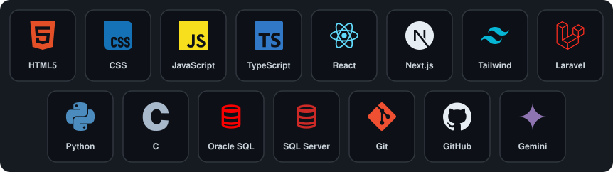

  

  

  
  

---

## Sobre

Estudante de Ciência da Computação e assistente administrativo de TI no Colégio Palmares. Meu foco atual é construir uma base sólida em programação, dados e redes, e busco uma oportunidade de estágio em TI, dados ou desenvolvimento back end.

| | |
|:--|:--|
| **Localização** | Osasco, São Paulo, Brasil |
| **Formação** | Bacharelado em Ciência da Computação, Universidade Anhembi Morumbi (2025–2029) |
| **Atuação atual** | Assistente administrativo de TI, Colégio Palmares (desde fev/2026) |
| **Objetivo** | Estágio em TI, dados ou desenvolvimento back end |
| **Em estudo** | Análise de dados (Python, SQL, Power BI, Pandas) e Java |

---

## Tecnologias

  

  
  
  
  
  
  
  

---

## Projetos

**Site de Fórmula 1** (em desenvolvimento)
Site com notícias e resultados da temporada 2025, tabela do campeonato com animação de posições e pontos, perfis de pilotos e páginas de GP com análise de treinos, classificação e corrida.
`Next.js` · `React` · `TypeScript` · `Tailwind CSS` · `shadcn/ui`

**Leitor de HQs** (em desenvolvimento)
Aplicação para gerenciar uma biblioteca de quadrinhos: exibição da capa ao adicionar cada arquivo, progresso de leitura salvo automaticamente, metas diárias e avaliação de 0 a 10 por título.

---

## Atividade no GitHub

  

  

---

## Formação e certificações

- **Bacharelado em Ciência da Computação**, Universidade Anhembi Morumbi (2025–2029)
- **Python para Dados: Primeiros Passos**, Alura (mar/2026, 10h)
- **Crie um Site Simples com HTML, CSS e JavaScript**, Fundação Bradesco (fev/2026)
- **Minicurso Elipse E3 v6.8 (HMI/SCADA)**, Elipse Software (dez/2025, 8h)
- **Imersão Dev com Google Gemini**, Alura (set/2025)
- **Modelagem de Dados**, Fundação Bradesco (set/2025)
- **Introduction to IoT**, Cisco (set/2025)
- **Introduction to Cybersecurity**, Cisco (set/2025)
- **Git e GitHub: compartilhando e colaborando em projetos**

---

## Contato

Aberto a oportunidades de estágio em TI, dados e desenvolvimento back end.

  
  

  

